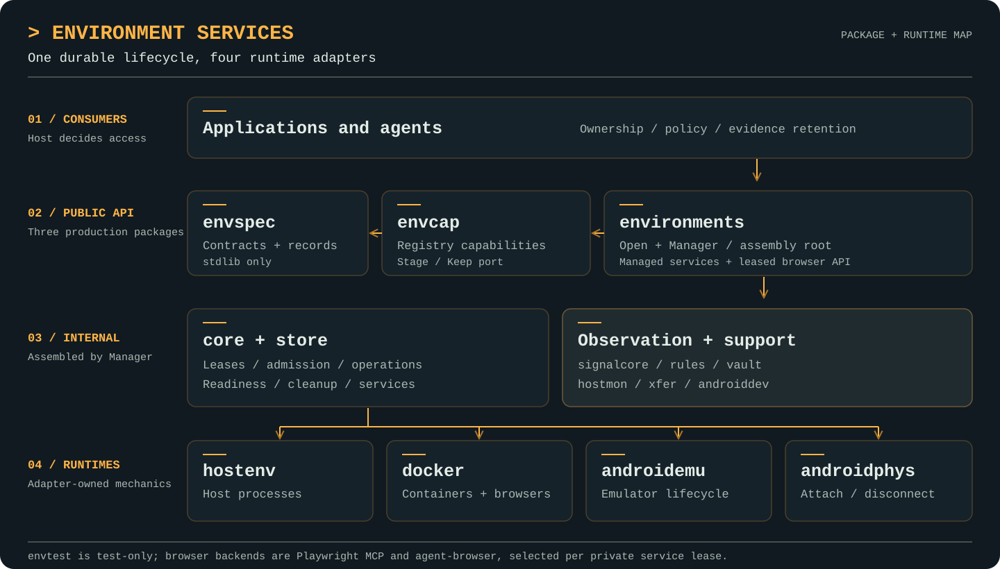

<picture>
  <source media="(prefers-color-scheme: dark)" srcset="docs/assets/craggy-wordmark-on-dark.svg">
  
</picture>

# Environment Services

A durable lifecycle manager for test environments: containers, Android
emulators and physical devices, and host processes. One core owns identity,
leases, admission, durable operations, readiness conditions and cleanup;
runtime adapters own the mechanisms. Observation (logs, packets, Frida,
device state) plugs in as supervised activities with receipt-grade records.

The module is `github.com/craggy-io/environment-services`. Consumers see three
production packages (`envspec`, `environments`, `envcap`) plus one test-only
package (`envtest`); everything else is `internal/`. This is a full cutover
with no legacy compatibility: fresh state directories and `craggy.*`
identities only, or nothing. Deploying over a previous stack means draining
it first.

The public APIs and the host and simulated-runtime paths are implemented and
tested. Live Docker, Android emulator and physical-device tests are opt-in (see
below); treat a backend as qualified only after running its live tests.

## Features

- **Durable lifecycle:** [provision, release, reset and attach are persisted
  operations](docs/environments.md) recorded before any runtime action, so a
  crash mid-flight resumes instead of leaking; release completes only on
  verified absence. Idempotent provisioning by request key, lease-epoch
  fenced handles, admission recomputed from durable rows.
- **Four runtimes, one core:** host processes, Docker containers, Android
  emulators and attached physical Android devices (attach/disconnect only,
  never create/destroy), behind one adapter contract with explicit
  present/absent/unknown observation.
- **Observation as evidence:** [versioned signal streams](docs/signals.md)
  (logcat, packets/flows/DNS/TLS/HTTP, binder, IPC, Frida, crashes, fs
  changes) with pins, coverage answers and loss accounting, so "nothing
  happened" is never confused with "nobody was watching".
- **Signal rules:** [stateful, budgeted Starlark rules](docs/rules.md) on
  script-services that emit derived signals, raise triggers and pin captures
  — and can never act on the world.
- **Capability surface:** [39 registry capabilities](docs/capabilities.md)
  over the same manager, with durable operation identities distinct from
  registry jobs and an injected artifact Stage/Keep port (this module has no
  artifact-services dependency).
- **Leased browsers:** a [single browser API](docs/browsers.md) over managed
  services selects Playwright MCP or Vercel agent-browser. Each lease gets a
  private container and session; navigation, accessibility snapshots, form
  actions and screenshots were exercised against a controlled local page.
- **Secrets stay secret:** a credential vault with leases, redaction before
  recording, and secret-typing that never lets a value leave the vault.
- **Small public surface, enforced layering:** `envspec` is
  standard-library-only (safe for domain packages to alias), and
  `arch_test.go` pins the whole import matrix.

## Package architecture

<p align="center">
  <a href="docs/assets/environment-services-architecture.svg">
    
  </a>
</p>

The diagram shows assembly and runtime flow. Imports are constrained by
`TestLayering` in [arch_test.go](arch_test.go): `envspec` is standard-library
only; `envcap` depends on `envspec`; `environments` assembles the internal
implementation. Browser leases use the managed-service path and the Docker
adapter, not a second lifecycle system.

| Package | Responsibilities | Imports (in this module) | Guide |
| --- | --- | --- | --- |
| `envspec` | Records and narrow interfaces: specs, profiles, handles, signal payloads, Android receipts. | none (stdlib only) | [envspec](docs/envspec.md) |
| `envcap` | The 39 registry capabilities, operation/evidence records, the artifact Stage/Keep port. | envspec | [capabilities](docs/capabilities.md) |
| `environments` | The one assembly root: `Open` + `Manager`, `Observation`, `AndroidDevice`, managed services and browser API, envcap adapter. | envspec, envcap, internal/* | [environments](docs/environments.md), [browsers](docs/browsers.md) |
| `envtest` | Test-only fakes (`FakeObservation`, `FakeServiceProvider`). Never for production. | envspec, environments | [signals](docs/signals.md#in-tests) |
| `examples/demo` | Assembly smoke test: provision → push/exec/pull → capabilities → drain. | envspec, environments, envcap | — |
| `internal/core` + `internal/store` | Durable lifecycle, leases, admission, operations, activities; profile loading through foundation-kit `bundle`. | envspec, adapter, hostmon, signalcore, vault, xfer | [design](docs/design.md) |
| `internal/adapters/{docker,hostenv,androidemu,androidphys}` | Runtime mechanisms and their owned collectors. | envspec, adapter, signalcore (+ own tech) | — |
| `internal/androiddev` + `internal/adb` | Device-over-serial surface, Frida, component supervisor; the adb transport. | envspec, adapter, signalcore | — |
| `internal/signalcore` | Hub, recorder, ranges, selector/filter matching. | envspec | [signals](docs/signals.md) |
| `internal/rules` | Starlark rule engine (the only script-services/Starlark importer). | envspec, signalcore | [rules](docs/rules.md) |
| `internal/vault`, `internal/hostmon`, `internal/xfer` | Credential leasing/redaction (own DB); host sampler; file-tree transfer (tar, manifests, delta). | envspec | — |

External confinement: `capability-services` only in `envcap` (+ demo),
`script-services`/`go.starlark.net` only in `internal/rules`, moby/gopacket
only in the docker adapter, and no artifact-services import anywhere.
Design notes: [docs/design.md](docs/design.md); see also
[AGENTS.md](AGENTS.md).

## Quick start

Open a manager over a fresh directory and see what it starts with. From
[`ExampleOpen`](environments/example_test.go), compiled and checked by
`go test`:

```go
mgr, err := environments.Open(ctx, environments.Config{Dir: dir, ManagerID: "mgr_example"})
if err != nil {
	panic(err)
}
defer mgr.Close(ctx, environments.ShutdownDisconnect)
// mgr.StockProfiles() → [android android-physical android-play android-play-rooted host-tools linux-tools]
// mgr.Drivers()       → hostenv always; docker/android by presence and config
// mgr.ProfileStatus("host-tools").Ready → true
```

To add or replace profiles, make `<Dir>/profiles` a bundle: a
[foundation-kit bundle](https://github.com/craggy-io/foundation-kit/blob/main/bundle/README.md)
folder with a `bundle.yaml` and one JSON profile per file (see
[Profiles](docs/environments.md#profiles)). A non-empty folder without a
`bundle.yaml` is an error at Open.

Then provision, work, release:

```go
h, err := mgr.Provision(ctx, owner, envspec.Spec{Profile: "host-tools", Key: "demo-host"})
err = h.Push(ctx, envspec.MemSource(map[string][]byte{"hello.txt": []byte("hello\n")}), "/work/in")
out, _, code, err := h.Exec(ctx, envspec.Cmd{Argv: []string{"cat", "in/hello.txt"}})
sink := envspec.NewMemSink()
err = h.Pull(ctx, "/work", sink)
err = mgr.Release(ctx, h.ID())
```

Run the whole path end-to-end (manager, host environment, push/exec/pull,
capability registration and invocation, drain):

```sh
go run ./examples/demo
```

The host adapter always registers; Docker needs a reachable daemon and
Android needs `Config.AndroidSDK` set. Set a stable `Config.ManagerID` for
any manager whose resources must be recognised across restarts, and call
`RenewLease` from a ticker for long-lived holds — using a handle never
renews its lease implicitly.

## Development and verification

Requires Go 1.27 or newer. Run `go build ./...`, `go vet ./...` and
`go test ./... -count=1` from this module. In the Craggy parent workspace,
use `GOWORK=off` for the module-graph architecture test; the parent `go.work`
includes sibling modules.

Live tests are skipped unless their environment variable is set:
`CRAGGY_TEST_DOCKER=1` (and `CRAGGY_TEST_DOCKER_BOOT=1`) for a real Docker daemon,
`CRAGGY_TEST_ANDROID_EMU=1` for an emulator,
`CRAGGY_TEST_ANDROID_PHYS_SERIAL=<serial>` for a physical device, and
`CRAGGY_TEST_ANDROID_XFER=1` with `CRAGGY_ADB_SERIAL=<serial>` for file transfer
on any connected device. See the
[documentation index](docs/README.md) and [verification evidence and limits](docs/verification.md).
