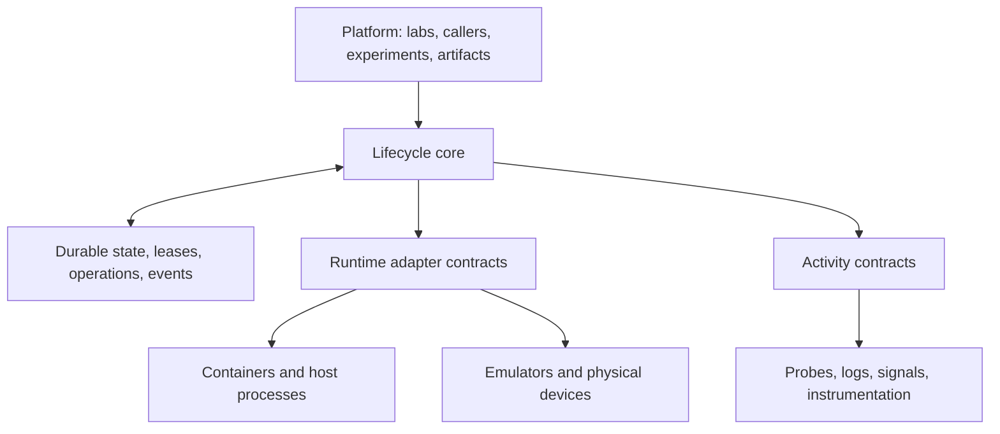

Yes. **A core lifecycle manager with adapters for devices, emulators, containers, and host processes is the separation I would adopt.** After inspecting the repositories, I think the redesign is justified.

The core should own the rules governing a resource’s lifetime: its desired state, ownership, leases, outstanding operations, readiness, recovery, and cleanup. Adapters should implement runtime-specific actions and report what they observe. Probes, log collection, and instrumentation should plug into a shared activity model.

Your state-tree idea is useful, with one refinement: **lifecycle, leasing, health, and collection are separate dimensions.** An emulator can be provisioned, leased, reachable, and missing Frida simultaneously. The model needs to express that combination directly.

I reviewed `cclab-environments` at [`249c34d`](https://github.com/philcantcode/cclab-environments/commit/249c34dbb05e00471a0b83e81d891ecb2bba6b29), `cclab-platform` at [`cac18b5`](https://github.com/philcantcode/cclab-platform/commit/cac18b513abec47729ef410f9f52b1bf9f452f91), and the relevant `craggy-io` repositories. The findings below come from source inspection; I have not reproduced them against running containers or emulators.

## Governing decisions: full cutover, no legacy

This design is implemented as a full cutover into a new module,
`github.com/craggy-io/environment-services`, under the decisions ratified in
[execution-plan.md §0](execution-plan.md). They override every migration,
compatibility or incremental-adoption suggestion that follows in this
document; where the analysis below still discusses the old system, it is
evidence for the redesign, not a behaviour to preserve.

| # | Decision |
|---|---|
| D1 | Clean drain. Fresh state DB, new `craggy.*` labels/names. No adoption, migration, or compat `state` projection. |
| D2 | Durable operations only for `provision \| release \| reset \| attach`. Exec/Push/Pull/device actions stay ephemeral, fenced by a handle epoch check. No second job system beside capability-services jobs. |
| D3 | Shutdown ships `Drain \| Disconnect` only. `Retain` deferred until an adapter can verifiably preserve. Crash recovery of pending operations is separate and mandatory. |
| D4 | Physical Android is new scope. `Attach` is in the adapter contract from Stage 3; the physical adapter is a late, droppable stage (5b). |
| D5 | Stream JSON frozen at current versions (`android.crash@2` etc.). No field renames. Golden decode of pre-cutover captures is a release gate. Gates domains may alias new record types or keep mirrors; aliasing is not mandated. |
| D6 | No `Overview` god-struct on the facade. Platform renders from `Profiles/List/EventsSince/HostSnapshot` plus envcap JSON capabilities it already shapes. |
| D7 | Generic `collect` package deleted. Each adapter owns its collectors. `internal/signalcore` is hub/recorder/range only. |
| D8 | Artifact port changes to `Stage/Keep` in v0.1.0, no `Put` shim. Cross-repo atomicity is handled by the pre-tag pseudo-version freeze (execution plan §6–§7). |
| D9 | Public surface is 3 production packages (`envspec`, `environments`, `envcap`) plus `envtest`, a chartered test-only package shipping `FakeObservation` instead of a collector-authoring API. |

Concretely: no `src/` layout, no `philcantcode/cclab-*` module paths, and no
`cclab.*` runtime labels, names or environment variables as identities for
anything the new code creates or recognises. Old resources are drained and
removed at cutover; foreign leftovers are reported, never adopted. Obsolete
code is fully removed — no deprecation markers, compatibility shims or
aliases (stream payload records move because consumers read them
concurrently; the old packages and types do not survive as aliases).

## 1. What would this change that a smaller fix would not?

The smallest useful comparison is to take the existing adapters and introduce failures around **claiming, provisioning, and releasing**. That distinguishes ordinary implementation bugs from problems requiring durable lifecycle management.

| Situation | What the current source does | Smaller correction | What the durable core adds |
|---|---|---|---|
| Destruction fails | `releaseEnv` discards the `Destroy` error and can record `gone` and return success. | Propagate the failure and preserve a pending state. | Persist the cleanup obligation, retry after restart, and verify removal before declaring completion. |
| Two callers request the same provisioning key | Key lookup and insertion are separate; `findByKey` only succeeds when `Get` can return a live handle. An in-progress request is therefore not reliably deduplicated. | Transactional uniqueness and an in-flight request record. | Both callers resolve to the same durable operation, including after a process restart. |
| Two callers claim a warm instance | Selection and ownership update are separate, without a conditional claim on the expected state. | Atomic compare-and-update. | Lease epochs and handle validation prevent previous holders from continuing to use a reassigned instance. |
| Manager restarts during provisioning or release | Recovery promotes discovered nonterminal resources to `ready`, including rows previously marked `releasing`. | Recovery rules specific to each prior state. | Resume the persisted intent: finish setup, continue deletion, or await verification. |
| Backend inventory cannot be read | A failed `Adopt` is skipped, after which unmatched live rows can become `lost`. | Distinguish unavailable inventory from confirmed absence. | Represent uncertainty explicitly and reconcile again when the backend returns. |

These behaviours are visible in the current [release path](https://github.com/philcantcode/cclab-environments/blob/249c34dbb05e00471a0b83e81d891ecb2bba6b29/src/env/leases.go), [provisioning and warm claims](https://github.com/philcantcode/cclab-environments/blob/249c34dbb05e00471a0b83e81d891ecb2bba6b29/src/env/provision.go), [state-store updates](https://github.com/philcantcode/cclab-environments/blob/249c34dbb05e00471a0b83e81d891ecb2bba6b29/src/env/state.go), and [startup reconciliation](https://github.com/philcantcode/cclab-environments/blob/249c34dbb05e00471a0b83e81d891ecb2bba6b29/src/env/manager.go#L463-L528).

Two further details strengthen the case:

- **Readiness is published before all setup finishes.** `Provision` places the handle in the live map and emits `env.ready` before credential injection and signal pinning. The synchronous call still waits, but other observers can see readiness earlier. Required setup and required instrumentation should be part of an explicit readiness decision. [Source](https://github.com/philcantcode/cclab-environments/blob/249c34dbb05e00471a0b83e81d891ecb2bba6b29/src/env/provision.go#L189-L229).
- **Recovery loses the admission-release callback.** Reconciliation re-reserves capacity using `admReserve`, but discards its returned release function instead of assigning it to the adopted environment. That leaves recovered capacity accounting disconnected from subsequent release. [Source](https://github.com/philcantcode/cclab-environments/blob/249c34dbb05e00471a0b83e81d891ecb2bba6b29/src/env/manager.go#L494-L538).

My assessment is therefore: **fix the obvious guards and error handling immediately, then consolidate these responsibilities into a durable core.** Merely adding more named states would leave the important crash and concurrency problems unresolved.

## 2. The separation I recommend

I would organize the system into four explicit areas.



### A. Lifecycle core

The core owns:

- Resource identities and generations.
- Desired state and current lifecycle phase.
- Lease acquisition, renewal, revocation, borrowing, and transfer.
- Admission and capacity reservations.
- Durable operation records.
- Transition guards and readiness evaluation.
- Retry scheduling, deadlines, and recovery.
- Cleanup obligations and confirmation.
- Lifecycle history and status projections.

It should be possible to test this package using a fake clock, a local state store, and fake adapters.

The core should know that an operation is “creating a managed resource” or “attaching to an existing resource.” It should not know how Docker networks, AVD snapshots, ADB forwarding, or Windows Job Objects work.

### B. Runtime adapters

Adapters own the mechanisms for interacting with a runtime.

| Adapter | Responsibilities |
|---|---|
| Docker | Images, containers, networks, sidecars, runtime inspection, execution, transfer. |
| Android emulator | AVD preparation, emulator processes, ports, boot observation, snapshots, emulator shutdown. |
| Physical Android device | Device discovery, identity verification, connection, disconnection, ADB transport, device capabilities. |
| Host process | Workspaces, process groups or Job Objects, process identity, execution, termination. |
| Future remote runtime | Remote identity, transport, provider APIs, reconciliation against the remote inventory. |

The existing repository already has a useful starting point: `Driver`, `Instance`, and optional interfaces for snapshots, transfer, components, and preparation. I would preserve the useful implementation behind those interfaces while making the lifecycle contract more precise. [Current driver interfaces](https://github.com/philcantcode/cclab-environments/blob/249c34dbb05e00471a0b83e81d891ecb2bba6b29/src/env/driver.go).

**The adapter reports facts and action results; the core decides the next lifecycle action.**

For example:

- Adapter: “The emulator process exists, but ADB did not answer.”
- Core: “Reachability is unknown; stop admitting new dependent work and retry the probe.”
- Adapter: “Container deletion timed out.”
- Core: “Deletion remains outstanding; retain its identity and reservation until inspection resolves the outcome.”

Runtime-specific substeps can stay inside an adapter when they do not need independent recovery. A network or forwarding session with its own cleanup obligations should be represented explicitly.

### C. Activities

Activities cover work that runs alongside a resource:

- Health probes.
- Lease renewal by an authorized holder.
- Log collection.
- Resource sampling.
- Frida attachment.
- Packet capture.
- Managed application supervision.

They share scheduling, cancellation, retry, and status machinery, while retaining their own implementations.

### D. Platform integration

`cclab-platform` should remain responsible for:

- Mapping authenticated callers to owners.
- Lab and session scope.
- Experiment policy.
- Selecting artifact destinations.
- Publishing outputs and evidence.
- Deciding what an investigation should do with a failure.
- UI and agent-facing presentation.

The existing repository rules already establish valuable boundaries: `envspec` is standard-library-only; core does not import sibling services; `envcap` provides the capability adapter; artifact storage is injected. Those are worth preserving. [Architecture rules](https://github.com/philcantcode/cclab-environments/blob/249c34dbb05e00471a0b83e81d891ecb2bba6b29/AGENTS.md).

## 3. How I would model the state tree

There are two useful hierarchies here:

1. **Resource ownership:** what belongs to an environment and must be cleaned up with it.
2. **Lifecycle substates:** what a controller is currently trying to accomplish.

Health and leases should appear alongside those hierarchies.

### Keep the dimensions explicit

| Dimension | Example values | Question it answers |
|---|---|---|
| Desired disposition | Present, released, retained | What should the manager work towards? |
| Lifecycle | Acquiring, configuring, present, draining, releasing, released | What lifecycle work is underway? |
| Observed presence | Present, absent, unknown | What has the runtime actually confirmed? |
| Lease | Unclaimed, held, draining, expired, revoked | Who has authority to use it? |
| Conditions | Reachable, booted, credentials ready, instrumentation ready | What is currently known to work? |
| Activities | Starting, running, backing off, stopping, stopped, failed | What supporting work is operating? |
| Cleanup | Pending obligations and their outcomes | What still needs to be removed or returned? |

For example, an environment could have:

```yaml
resource: env_example
instance_generation: 7
lifecycle: present

lease:
  holder: job_example
  epoch: 12
  state: held

conditions:
  reachable: true
  boot_complete: true
  frida_ready: false

activities:
  logcat: running
  frida_attachment: backing_off

readiness:
  shell_execution: true
  instrumented_experiment: false
```

That is a much more useful description than a single `unhealthy` state.

Hierarchical statecharts support this distinction: compound states describe nested alternatives, while parallel regions describe simultaneously active state dimensions. You can adopt those semantics without introducing an SCXML interpreter. [w3.org](https://www.w3.org/TR/scxml/?utm_source=chatgpt.com)

### Use nested states where they clarify recovery

Useful lifecycle paths could include:

- `Acquiring.WaitingForCapacity`
- `Acquiring.Creating`
- `Acquiring.Attaching`
- `Acquiring.Configuring`
- `Acquiring.Verifying`
- `Present`
- `Releasing.Draining`
- `Releasing.FinalizingEvidence`
- `Releasing.Detaching`
- `Releasing.Deleting`
- `Releasing.VerifyingCleanup`
- `Released`

A failed operation does not necessarily mean the resource disappeared. Creation can fail after creating a network; deletion can fail after stopping a process. The resource record must survive while there are unresolved external effects.

### Represent uncertainty and freshness

Each condition should carry:

- `True`, `False`, or `Unknown`.
- A stable reason code.
- The time it was observed.
- The generation it describes.
- A freshness limit.
- Supporting diagnostic information.

Kubernetes uses `True/False/Unknown` conditions and `observedGeneration` to identify observations made against an older specification. For your system I would additionally track observation freshness, because an old successful probe is not proof of current health. [Go Packages](https://pkg.go.dev/k8s.io/apimachinery/pkg/apis/meta/v1?utm_source=chatgpt.com)

**Unknown should block decisions that require certainty.** It should not automatically prove that a device is dead, that deletion succeeded, or that the resource can be reassigned.

### Distinguish ownership from dependency

A strict resource tree is insufficient for shared dependencies.

An emulator might own its process and forwarding sessions, while depending on a shared ADB server and a shared base AVD. Releasing the emulator must not destroy those shared dependencies.

I would use explicit relationships such as `owns`, `borrows`, and `depends_on`, while presenting the main ownership structure as a tree in the UI. Only objects with meaningful lifetime, authority, or recovery requirements need resource records.

## 4. What makes the core durable

The central mechanism should be a **reconciliation loop**: compare durable intent with current observations, then perform the next permitted action.

This is the same broad pattern used by controllers managing external resources: desired state is persisted, observations describe current state, and repeated reconciliation moves the resource towards its desired state. [Kubernetes](https://kubernetes.io/docs/concepts/architecture/controller/?utm_source=chatgpt.com)

### Persist operations before executing them

For provisioning:

1. Validate the request and its ownership scope.
2. In one transaction, record the resource, request key, operation, and applicable reservation.
3. Dispatch the adapter action outside the database transaction.
4. Record the result against the expected resource generation and operation.
5. Verify readiness.
6. Make the usable handle available.

A useful operation record contains:

| Field | Purpose |
|---|---|
| Operation ID | Stable identity across retries and recovery. |
| Resource ID and instance generation | Identifies the exact resource incarnation. |
| Desired-state revision | Prevents obsolete work from overriding newer intent. |
| Lease ID and epoch | Associates the action with valid authority. |
| Request key and request digest | Deduplicates retries and rejects conflicting reuse. |
| Phase and attempt | Makes progress and retry state durable. |
| Deadline and next-attempt time | Allows scheduling to resume after restart. |
| External identities | Finds containers, processes, networks, and attachments already created. |
| Outcome classification | Distinguishes success, definite failure, and unknown outcome. |

Caller-provided request identifiers are particularly useful here: two identical specifications can legitimately request two resources, while the same request identifier should refer to the same intent. AWS’s idempotency guidance also treats reuse of an identifier with different parameters as a distinct error case. [aws.amazon.com](https://aws.amazon.com/builders-library/making-retries-safe-with-idempotent-APIs/?utm_source=chatgpt.com)

A local operation record does not make Docker or ADB transactional. The adapter contract must explain how a retry discovers an earlier result, uses provider deduplication, or reports that the outcome remains uncertain.

**Arbitrary commands should not be automatically replayed merely because their completion record is missing.** Creating a discoverable container and rerunning a target-mutating command have different recovery semantics.

### Guard every state change

For a single-host implementation, I would use:

- One manager owner per state directory.
- Serialized mutations for each resource.
- Database uniqueness for request keys and exclusive claims.
- Conditional updates against the expected revision.
- Generation checks on asynchronous results.
- Explicit cancellation and completion acknowledgement.
- Periodic reconciliation as a fallback for missed notifications.

The existing exclusive manager lock is a sensible foundation. There is no immediate need to add distributed leadership.

Critical database errors should stop new state-changing work. The current pattern of discarding errors from some lifecycle updates defeats the purpose of durable state.

### Treat cleanup as outstanding work

Release should record an intention to release, followed by explicit obligations:

- Stop accepting new work.
- Drain or terminate existing work according to policy.
- Finalize required evidence.
- Stop owned activities.
- Remove owned attachments and runtime resources.
- Confirm cleanup.
- Return capacity and complete the release.

If the runtime is unavailable, the record remains pending with a reason and next retry. Kubernetes finalizers provide a useful precedent: deletion intent is recorded first, and completion waits for cleanup conditions. [Kubernetes](https://kubernetes.io/docs/concepts/overview/working-with-objects/finalizers/?utm_source=chatgpt.com)

Your existing lifecycle event table already supports state-and-event writes in the same transaction. I would retain that approach and strengthen its use, rather than introduce a second event system. [Current transactional state and events](https://github.com/philcantcode/cclab-environments/blob/249c34dbb05e00471a0b83e81d891ecb2bba6b29/src/env/state.go).

### Make handles lease-aware

A handle should represent an authorized relationship to a particular incarnation:

- Resource ID.
- Instance generation.
- Lease ID.
- Lease epoch.
- Granted capabilities.

Check that relationship before execution, transfer, reset, and other mutations. Ownership changes must also drain or terminate earlier work before reuse.

This is especially relevant to warm pools: the current release path can reset and reuse the same `*Env` object. A generation-bound handle would give previous holders a clear, permanent invalidation point. [Warm reset and reuse](https://github.com/philcantcode/cclab-environments/blob/249c34dbb05e00471a0b83e81d891ecb2bba6b29/src/env/leases.go#L145-L181).

A lease timeout alone cannot prevent an old command from arriving late. Chubby’s original design addresses this through sequencers that the receiving service validates. For your first version, route operations through the single manager and require confirmed quiescence before reassignment; any future remote executor must enforce the corresponding epoch at its execution boundary. [usenix.org](https://www.usenix.org/legacy/event/osdi06/tech/full_papers/burrows/burrows_html/?utm_source=chatgpt.com)

## 5. The adapter contract needs to distinguish created and attached resources

This matters directly to your physical-device idea.

| Resource relationship | Acquisition | Release |
|---|---|---|
| Managed container | Create or recover a verified owned container. | Destroy its owned resources. |
| Managed emulator | Boot or claim a verified clean instance. | Destroy, or reset and return to a warm pool. |
| Physical device | Verify identity, obtain exclusive access, connect, configure permitted attachments. | Remove owned attachments, disconnect, release its lease. |
| Existing external service | Verify identity and connection requirements. | Close the owned connection or borrow. |
| Managed host workspace | Create workspace and process group. | Stop owned processes and remove or retain the workspace according to policy. |

“Release” should therefore accept an explicit disposition. Destruction, clean reset, preservation, and disconnection are different operations.

### Prefer a small mandatory interface and optional capabilities

The common adapter contract should cover:

| Contract | Required semantics |
|---|---|
| Describe | Declares supported resource kinds, capabilities, and adapter version. |
| Validate | Validates adapter-specific configuration without provisioning. |
| Observe | Reports presence and conditions; distinguishes absence from inability to observe. |
| Discover | Finds candidates within an explicit ownership scope for recovery. |

Additional interfaces can provide:

- Provisioning and deletion.
- Connection and disconnection.
- Execution.
- File transfer.
- Snapshot and reset.
- Log sources.
- Component probes and repair.
- Resource measurements.

A physical phone should not need a meaningless `Create` method. A container should not pretend to support every device operation.

All actions should receive the operation identity and resource generation. They should return typed outcomes and external identities, rather than directly updating the manager’s database.

For Android specifically, I would separate **emulator lifecycle** from **Android device access**. Both an emulator and a physical device can reuse the ADB transport and relevant instrumentation components, while keeping their acquisition and release semantics separate.

## 6. Default phases and background activities

Your proposed defaults are valuable. I would distinguish setup barriers from work that continues throughout a resource’s lifetime.

### Default setup barriers

A profile can request:

1. Admission or device reservation.
2. Provisioning or attachment.
3. Identity verification.
4. Configuration and credential delivery.
5. Required component preparation.
6. Required collection attachment.
7. Readiness verification.

Only the relevant barriers apply to a particular adapter.

The exact timing matters. If a test requires capture before the target starts, the core must wait for that collector’s readiness acknowledgement before launching the target. If an adapter starts the runtime inside one indivisible operation, the system should expose the resulting capture limitation.

### Supervised activities

Each probe, collector, or attachment should declare:

- Its target generation.
- Preconditions and dependencies.
- Desired running or stopped state.
- Whether it blocks a particular readiness requirement.
- Timeout, retry classification, backoff, and retry budget.
- Cancellation and shutdown acknowledgement.
- Last successful observation.
- Collection cursor or coverage information, where supported.

An important existing seam is that the generic signal hub removes an exited collector from its running map and reports the failure; it does not itself persist and reconcile the desired attachment. Some collectors implement their own retry loop. A shared activity controller would make that responsibility consistent. [Hub lifecycle](https://github.com/philcantcode/cclab-environments/blob/249c34dbb05e00471a0b83e81d891ecb2bba6b29/src/signal/hub.go#L241-L329), [collector retry helper](https://github.com/philcantcode/cclab-environments/blob/249c34dbb05e00471a0b83e81d891ecb2bba6b29/src/collect/collect.go#L308-L339).

Keep expensive collection opt-in through profiles or explicit requests. The default framework can manage packet capture without making every environment capture packets.

### Separate the heartbeats

There are at least four different signals:

| Signal | What it establishes |
|---|---|
| Controller heartbeat | The manager or worker is making contact. |
| Holder renewal | An authorized owner still wants its lease. |
| Target probe | A particular target capability responded. |
| Job progress heartbeat | The application is reporting ongoing work. |

One should not silently substitute for another. In particular, routine monitoring should not perpetually renew a departed owner’s lease.

The platform’s existing `envjob.Heartbeat` is a progress timer. It is not a lease renewal or an environment-health guarantee. [Current implementation](https://github.com/philcantcode/cclab-platform/blob/cac18b513abec47729ef410f9f52b1bf9f452f91/src/core/envjob/envjob.go#L340-L366).

### Preserve research evidence during repair

The current Android supervisor already has a valuable policy: capture before repair, repair instrumentation rather than the target, and stop repeated repairs when failures look suspicious. Preserve that behaviour. [Supervisor](https://github.com/philcantcode/cclab-environments/blob/249c34dbb05e00471a0b83e81d891ecb2bba6b29/src/android/supervisor.go).

I would add a core mutation-policy hook that every autonomous repair passes through. During a controlled experiment, a policy might allow passive observation while preventing instrumentation restart or device reset.

That hook is necessary because the platform’s current experiment guard operates at registry invocation boundaries. It cannot, by itself, govern repairs initiated inside a background controller. [Experiment guard](https://github.com/philcantcode/cclab-platform/blob/cac18b513abec47729ef410f9f52b1bf9f452f91/src/core/application/gate_experiment.go#L43-L97).

## 7. Platform contracts to preserve

Three integration points deserve explicit treatment.

### Shutdown policy

The platform currently calls `ReleaseAll` with a 30-second bound before closing the environment stack. Consequently, a more durable manager will not automatically make resources survive graceful platform restarts. [Shutdown implementation](https://github.com/philcantcode/cclab-platform/blob/cac18b513abec47729ef410f9f52b1bf9f452f91/src/core/application/environments.go#L180-L211).

Introduce explicit shutdown policies such as:

- Drain and destroy managed resources.
- Retain eligible resources for bounded recovery.
- Disconnect from externally owned resources.
- Emergency termination.

Retention must depend on what the adapter can actually preserve. Service reconnection and workload resumption require separate verification.

### Job finalization and managed services

The platform already has an environment-job pipeline that stages inputs, runs phases, retains outputs on detached cancellation contexts, and releases resources. Keep its artifact-publication policy in platform, with the lifecycle core enforcing durable cleanup.

There are two inexpensive fixes here: the stop path discards the stop command’s exit status, and the release closure discards release errors. Those should be fixed independently of the redesign. [Job lifecycle](https://github.com/philcantcode/cclab-platform/blob/cac18b513abec47729ef410f9f52b1bf9f452f91/src/core/envjob/envjob.go).

Ghidra has a different contract: a generation-aware managed service, a borrower lease, and an exclusive transaction lock held through artifact publication. Those identities must remain distinct. Releasing one borrower should not automatically destroy a shared service. [Ghidra service coordination](https://github.com/philcantcode/cclab-platform/blob/cac18b513abec47729ef410f9f52b1bf9f452f91/src/core/ghidra/service.go).

### Readiness and status ownership

Platform currently patches profile readiness when a driver is missing and separately guards provisioning. Move that knowledge into the manager’s authoritative readiness model. [Current readiness wrappers](https://github.com/philcantcode/cclab-platform/blob/cac18b513abec47729ef410f9f52b1bf9f452f91/src/core/application/environments.go#L295-L355).

There is no compatibility projection (D1): the new manager reports structured lifecycle, lease, condition, activity and cleanup information only, and consumers cut over to it in the same programme. Within the new store, event sequence cursors and owner/session/job attribution are preserved exactly as designed above — that is a property of the new event log, not a migration of old data.

## 8. Planning the `craggy-io` migration

The capability migration is already partly complete:

- Environments already uses `capability-services v0.1.0`.
- Platform already uses `capability-services v0.1.0` and `script-services v0.1.0`.
- Platform still depends on `cclab-storage`, `cclab-classify`, and other older modules. [Environment dependencies](https://github.com/philcantcode/cclab-environments/blob/249c34dbb05e00471a0b83e81d891ecb2bba6b29/go.mod), [platform dependencies](https://github.com/philcantcode/cclab-platform/blob/cac18b513abec47729ef410f9f52b1bf9f452f91/go.mod).

| Concern | Destination | Recommended boundary |
|---|---|---|
| Capability invocation and job presentation | `capability-services` | `envcap` and platform integration. |
| Artifact storage, publication, lineage | `artifact-services` | Platform’s shared artifact bridge. |
| Shared Starlark execution mechanics | `script-services` | Behind the rules implementation. |
| Classification | `classification-services` | Platform/output processing. |
| Resource lifecycle, leases, admission, recovery | Environment lifecycle core | No matching replacement was identified among the four accessible Craggy repositories. |

### Capability jobs are a projection

The pinned capability-services documentation says jobs are tracked in memory; its optional journal restores interrupted jobs as lost and does not resume handlers or reserve physical resources. Therefore the environment operation store must remain authoritative. [Pinned job semantics](https://github.com/craggy-io/capability-services/blob/629124605959dc6b08dea0269d3e2d1c506b2b85/docs/jobs.md).

Keep registry job ID, durable operation ID, resource generation, and lease identity separate.

### Artifact migration requires semantic translation

I found several concrete compatibility issues:

| Issue | Migration requirement |
|---|---|
| Artifact identity | Preserve lab/store scope and occurrence identity alongside content-addressed snapshot identity. |
| Output timing | Current `Put` returns an ID during the callback; new run outputs are staged and finalized later. Adapt the contract explicitly. |
| Failed-run evidence | Preserve completed partial outputs and their evidence deliberately. |
| Filesystem metadata | Preserve executable modes, empty directories, and symlinks through a tested representation. |
| Concurrent run reuse | Keep provisioning exclusivity in the lifecycle core. |

The symlink issue is particularly concrete: existing `envspec.Entry` uses Unix file-type bits and target bytes; artifact-services permits permission bits in `Mode`, and its `KindLink` embeds another artifact rather than representing a filesystem symlink. [Existing transfer types](https://github.com/philcantcode/cclab-environments/blob/249c34dbb05e00471a0b83e81d891ecb2bba6b29/src/envspec/envspec.go), [new artifact types](https://github.com/craggy-io/artifact-services/blob/c32c77a89a73f27405ee72daa20759e75ead4c66/artifacts/artifacts.go).

Also, artifact-services explicitly allows racing executors to each run a callback, with only one committing the winning outputs. That is unsuitable as the exclusivity mechanism for creating containers or resetting devices. [Run adapter semantics](https://github.com/craggy-io/artifact-services/blob/c32c77a89a73f27405ee72daa20759e75ead4c66/docs/adapters.md).

Do not preserve the existing installation identity (D1). The new manager starts from a fresh state directory under new `craggy.*` labels and names, and must never recognise or adopt resources created by the old one. The cutover runbook drains and force-removes old resources first (assuming leaks, since the old code discards Destroy errors); anything foreign left behind is surfaced through the new manager's `Warnings` and removed by hand, never adopted. Platform stops deriving the runtime manager label from its durable store ID — that wiring existed only so the old manager could re-recognise its own resources. [Manager identity wiring](https://github.com/philcantcode/cclab-platform/blob/cac18b513abec47729ef410f9f52b1bf9f452f91/src/core/application/environments.go#L130-L169).

### Reuse script mechanics while preserving rule behaviour

Use script-services for compilation, conversions, and bounded callbacks. Keep signal windows, subscriptions, mutable rule state, virtual time, and trigger policy in the rules layer.

The defaults differ materially: environment rules currently use a one-million-step, 250 ms budget, while script-services defaults to five million steps and ten minutes. Its general execution entry point also freezes globals. Preserve the existing rule semantics explicitly. [Rules](https://github.com/philcantcode/cclab-environments/blob/249c34dbb05e00471a0b83e81d891ecb2bba6b29/src/rules/rules.go), [pinned script API](https://github.com/craggy-io/script-services/blob/f07d978278e85f9eec941336f8b1f127cb2af88c/script/script.go).

## 9. What is worth splitting into separate repositories?

**Separate the code boundaries first. Extract repositories when the component has an independent consumer or release lifecycle.**

| Area | Recommendation | Reason |
|---|---|---|
| Lifecycle, leases, admission, operations, cleanup | Keep together in one core repository. | Their correctness depends on shared invariants and transactions. |
| Runtime adapters | Separate packages immediately; separate modules or repositories selectively. | Gives clear isolation while contracts are still evolving. Android may eventually justify its own release cycle. |
| Generic signal hub, recorder, ranges, quality tracking | Strongest extraction candidate. | Useful beyond environments, including application monitoring and simulation observability. |
| Signal rules | Keep with signals initially. | Closely tied to stream windows, timers, captures, and signal semantics. |
| Credential leasing and redaction | Good conditional candidate. | Has its own database and policy model; extraction becomes worthwhile with a second real consumer. |
| Transfer engine and helper protocol | Keep as a package initially. | Already has a useful narrow boundary; independent reuse should justify a separate release. |
| ADB protocol client | Plausible standalone library later. | Clear low-level API that can serve emulator and physical-device adapters. |
| Capability adapter | Keep adjacent to the environment API, optionally as a submodule. | Changes closely track the domain API. |

Signals need some preparation before extraction: the generic stream machinery should be separated from the current target abstraction that exposes environment execution and driver handles. [Signal contracts](https://github.com/philcantcode/cclab-environments/blob/249c34dbb05e00471a0b83e81d891ecb2bba6b29/src/signal/signal.go).

The vault is currently explicitly scoped to environment test credentials. I would preserve that scope unless a broader credential service has a concrete consumer. [Vault implementation and scope](https://github.com/philcantcode/cclab-environments/blob/249c34dbb05e00471a0b83e81d891ecb2bba6b29/src/vault/vault.go).

I would defer extracting a universal state-machine or generic lease repository. Resource leases, credential policies, and application transaction locks have overlapping mechanics but different semantics.

## 10. The implementation sequence I would choose

### First: establish the failure contract

Add focused regression scenarios for the source findings, and fix the straightforward error-handling and atomicity problems.

The decisive tests are:

| Fault injected | Required result |
|---|---|
| Concurrent identical provisioning requests | One durable operation and one intended resource. |
| Concurrent warm claims | One successful exclusive claim. |
| Crash after creation but before result persistence | Recovery finds the created resource. |
| Release during provisioning, followed by late success | The resource remains scheduled for cleanup. |
| Backend unavailable during recovery | Presence becomes unknown; absence is not invented. |
| Destruction failure | Cleanup remains visible and retryable. |
| Old handle used after reassignment | Operation is rejected. |
| Collector dies while required | Readiness reflects the missing requirement and retry is supervised. |
| Experiment holds mutation authority | Autonomous repair obeys the experiment policy. |
| Recovered environment is released | Its capacity reservation is correctly returned. |

The repository already has fake drivers and lifecycle tests to build on. Extend those around crash boundaries and interleavings. [Existing environment tests](https://github.com/philcantcode/cclab-environments/blob/249c34dbb05e00471a0b83e81d891ecb2bba6b29/src/env/env_test.go), [lifecycle tests](https://github.com/philcantcode/cclab-environments/blob/249c34dbb05e00471a0b83e81d891ecb2bba6b29/src/env/lifecycle_test.go).


### Then: build the new module outright, in stages

There is no incremental path behind the old API (D1). The design is built as
a new module in stages S0–S10 ([execution-plan.md §7](execution-plan.md)),
each landing green (build, vet, tests, architecture tests) before the next:

1. Records first (`envspec`, standard-library-only) with golden JSON tests
   captured from the old code, freezing the stream wire contract (D5).
2. Foundation ports (adb, host monitor, transfer, signal hub/recorder,
   vault), then the durable core: versioned persistence for operations,
   generations, conditions, activities and cleanup obligations, proven
   against two fake adapters — one that creates resources and one that
   attaches to existing devices — so container assumptions surface early.
3. Real adapters with their own collectors (host, Docker, then Android with
   device access separated from emulator lifecycle; physical attach is a
   late, droppable stage), managed services as activities, and the rules
   engine rebuilt on script-services behind its existing behaviour tests.
4. Assembly (`environments`), the capability surface (`envcap`, with the
   artifact Stage/Keep port and no artifact-services dependency), and
   hardening: architecture matrix, dead-code and race passes, the
   clean-drain cutover runbook.

Consumers cut over in lockstep after a pre-tag pseudo-version freeze:
gates first, then platform (readiness ownership moves into the manager,
explicit `Drain | Disconnect` shutdown, managed-service generations and
evidence-before-repair preserved as behaviours of the new core, artifact
round-trips for files, modes, directories, symlinks and failed-operation
evidence as gates). There is exactly one authoritative controller per
resource at all times because the old stack is drained and stopped before
the new one starts; rollback is the old platform with its archived state
directory, after draining `craggy.*` resources. Nothing is extracted into
separate repositories in this programme (§9 is deferred entirely).

**The first implementation milestone is a durable acquire–observe–release controller that passes the crash and concurrency cases above using both a created resource and an attached device.** That establishes the core mechanism, while giving the remaining adapters and default activities a clear contract to implement.
